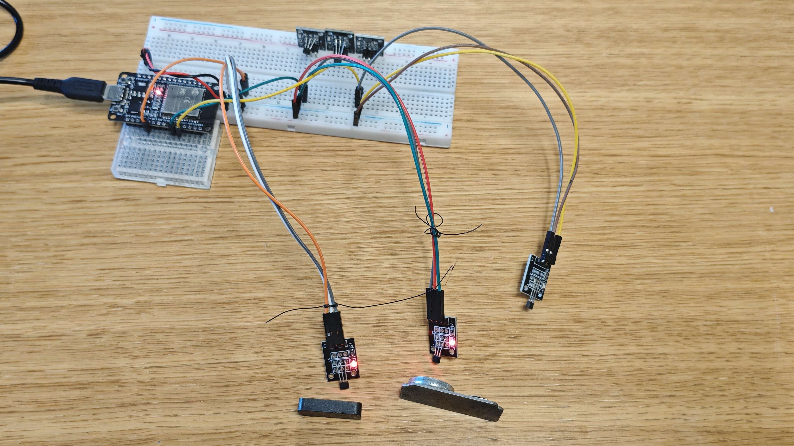

# 🔮 Project: Aether-Wand Arcade (Working Title)

> **An invisible-interface arcade game where magnetic interactions bridge the physical and digital worlds.**

*Figure 1: Proof-of-concept breadboard. 3x Hall Effect sensors wired to an ESP32. Two sensors are actively triggered by neodymium magnets (LEDs ON), one is idle (LED OFF).*

---

### 🧠 The Origin & Thought Process

This project was born out of the Robotics Club Game Night, requiring a competitive scoring system (1-10 XP). The ideation process went through several deliberate phases to ensure the final product would be both novel and highly engaging:

**Phase 1: The Standalone Robotics Game**

Initially, the goal was to build a game running entirely on a microcontroller (ESP32/Arduino), utilizing LEDs, small screens, and sensors. However, after evaluating several concepts (RPM cranks, distance guessing, pendulum drops), it became clear that while feasible, the games felt constrained. They lacked the visual and interactive depth required to sustain a fun, competitive environment for a game night.

**Phase 2: Pivoting to Custom Controllers**

To solve this, we pivoted our strategy. Instead of forcing a game to run natively on the limited hardware, we decided to use the microcontroller and sensors as a **custom physical controller** for a more robust PC game (built in Godot). This allowed us to separate the "fun" of the physical interaction from the processing limitations of the board.

**Phase 3: Selecting the Sensor (The Novelty Factor)**

When evaluating which sensors to use for the controller, we looked at potentiometers (sliders), rotary encoders (dials), and standard arcade buttons. We realized that these inputs mimic standard, everyday controllers (joysticks, steering wheels, buttons). Using them would result in a familiar, but not particularly novel, experience. 

We wanted an interaction that felt different—something invisible and highly interactive. This led us to select the **Hall Effect sensor**. By hiding these magnetic switches beneath a smooth 3D-printed surface and giving the player a wand or sword with an embedded magnet, we created "invisible buttons." 

**Phase 4: Hardware Validation**

Before committing to game design, we rigorously tested the Hall sensors. We confirmed that they are bulletproof (digital ON/OFF, no analog jitter), capable of reading fast "swiping" motions with zero latency, and can reliably detect magnets through physical 3D-printed plastic. The core mechanic was proven viable.

---

### ⚙️ Tech Stack
*   **Microcontroller:** ESP32
*   **Sensors:** Digital Hall Effect Sensors
*   **Game Engine:** Godot Engine (using GDScript)
*   **Communication:** USB Serial (ESP32 -> PC)

---

### 🕹️ Current Game Concept & Mechanics (In Development)

The specific game design is currently in the active ideation phase. The physical interaction is locked in, but the digital response is being explored. 

**Current Design Directions:**
*   **The Physical Prop:** The player will hold a 3D-printed prop (currently leaning toward a wand or a sword) with an embedded neodymium magnet.
*   **The Interaction:** The game will be triggered by specific sensors being activated, or by the *sequence* in which the sensors are swiped/tapped.
*   **The Theme:** We are exploring a combat-oriented theme, where swiping the sensors translates to strikes, parries, or spellcasting in the game.
*   **Multiplayer:** There is strong potential for a 1v1 PvP mode, where two players use their physical props simultaneously to battle on screen.

---

### 📊 Project Roadmap & Status

| Phase | Description | Status | Notes |
| :--- | :--- | :--- | :--- |
| **Phase 1** | Hardware Validation (Sensors & ESP32) | ✅ **Complete** | 6 sensors tested. Fast taps and 3D-printed plastic penetration confirmed. |
| **Phase 2** | Game Design & Mechanics Finalization | 🔄 **In Progress** | Finalizing the game idea, combat mechanics, and PvP viability. |
| **Phase 3** | 3D Printed Assets & Enclosure Design | 🔄 **In Progress** | Designing the physical layout. The 3D design is a core game mechanic that dictates how the player interacts with the invisible sensors. |
| **Phase 4** | Firmware & Serial Protocol | ⏳ **Pending** | Writing C++ code to send clean Serial data (e.g., `L`, `C`, `R`) to PC. |
| **Phase 5** | Game Engine Core (Godot) | ⏳ **Pending** | Setting up Godot project, reading Serial data, and building the visual game loop. |
| **Phase 6** | Polish & Game Night Prep | ⏳ **Pending** | Sound effects, lighting, and 1-10 XP scoring integration. |

---

### 🚀 Next Steps
1. Finalize the core game loop (Solo Combat vs. 1v1 PvP).
2. Draft the 3D layout of the sensor array and the physical prop.
3. Begin prototyping the serial communication bridge between the ESP32 and Godot.
