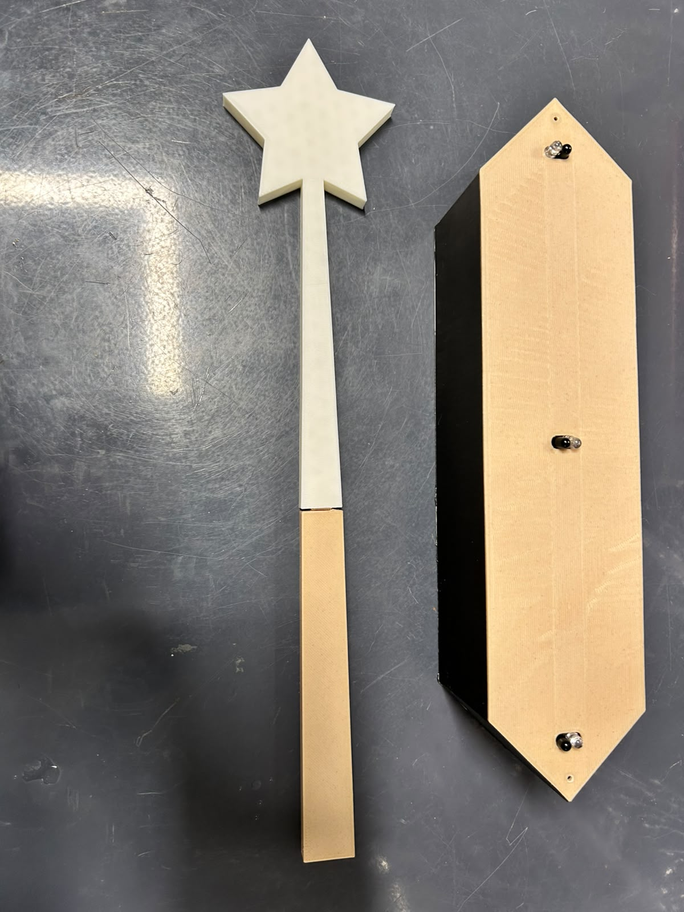
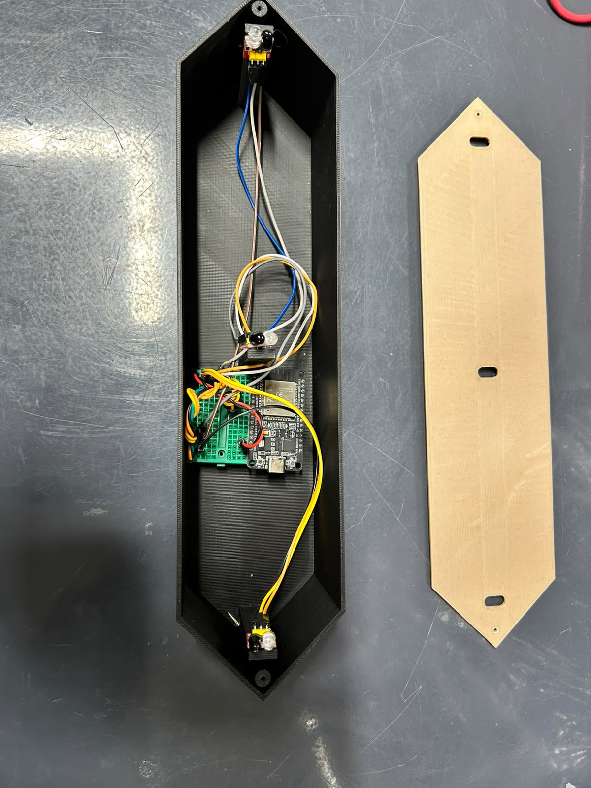
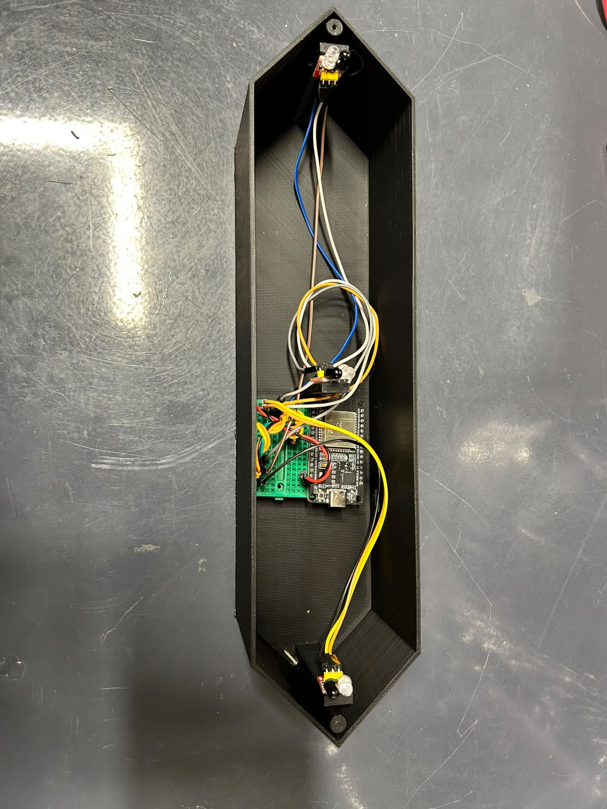

# Aether-Wand-Arcade · Runeweave

Runeweave is a video game you play with a real, physical wand — not a keyboard or a gamepad.

You stand in front of three sensors. You hold a small 3D-printed wand. Monsters walk toward you on screen, and you wave the wand over the sensors in the right order to cast spells and defeat them before they reach you.

It was built for a robotics club game night. People played it, competed for high scores, and it went well.

---

## What's in this repo

| Folder | What it is |
|---|---|
| `final_game/` | The game itself — built in Godot 4.5.1. All the code, art, and scenes. |
| `firmware/` | The code that runs on the ESP32 (the small computer inside the wand controller). |
| `hardware/` | How to wire the sensors to the ESP32. |
| `models/` | 3D-printable files for the wand and sensor mount (coming soon). |
| `assets/images/` | Photos of the build. |

---

## How the game works

Monsters come at you in three lanes — left, center, and right. Each monster shows a symbol telling you which element defeats it.

1. **Prepare your spell** — wave the wand over any three sensors. The pattern you use decides which element you get:
   - Wave over the same sensor twice or three times → that element wins.
   - Wave over all three different sensors → the last one you used decides.
2. **Release the spell** — wave over the sensor of the lane you want to hit. Time it so the spell lands when the monster crosses the middle line.
3. **Score** — right element + right lane + good timing = the most points. Wrong element still hurts the monster a bit. Wrong lane or bad timing = nothing.

A full round is **60 seconds**, **21 monsters**, and **84 inputs**. You get a score from **1.0 to 10.0** at the end.

---

## How the controller works

The wand controller is a small computer called an ESP32 with three infrared sensors attached. When you wave the wand over a sensor, the sensor notices and tells the game. The game then shows your spell flying at the monster.

It all happens almost instantly — under 2 milliseconds from wave to spell.

You don't need to understand any of that to play. You just wave the wand over the sensors and the game does the rest.

See [`final_game/docs/esp32-sensor-guide.md`](final_game/docs/esp32-sensor-guide.md) for the full explanation.

---

## Photos

---

## Want to build one yourself?

You'll need:
- An **ESP32** — a small, cheap programmable board (about $5)
- **Three infrared sensors** — the kind that detect when something is close
- A **3D-printed wand** and sensor mount (files coming to `models/`)
- A computer with **Godot 4.5.1** installed

Start with [`hardware/README.md`](hardware/README.md) for the wiring, then [`firmware/README.md`](firmware/README.md) for the code that goes on the ESP32.

---

## License

MIT — see [`LICENSE`](LICENSE). You're free to copy, modify, and share.
